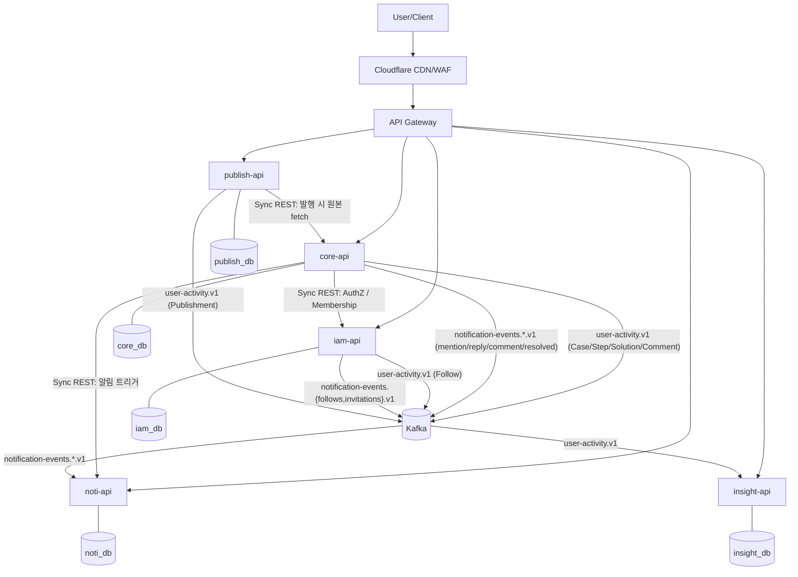
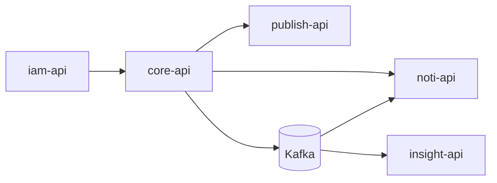

# Error Archive
> 문제 해결 과정을 구조화하여 개인 · 팀 · 커뮤니티의 지식 자산으로 축적하는 플랫폼
> 단순 "에러 저장"이 아니라, 해결에 이르는 **시도 / 상태(진행·실패·해결) / 솔루션**의 흐름을 타임라인으로 남기고, 상황에 따라 워크스페이스 · 팔로워 · 공개 페이지로 공유합니다.

---

## Why?
개발자가 장애/에러를 경험할 때 반복되는 고통은 "원인"이 아니라 "과정"이 사라지는 데서 시작합니다.
- 같은 에러를 몇 달 뒤 다시 겪는다.
- 해결을 했는데, **왜 해결됐는지** 문서화가 부족하다.
- 팀원이 해결한 경험이 **팀의 자산으로 축적되지 않는다**.
- 블로그 / 위키 / 이슈 트래커는 "기록"은 가능하지만, **해결 과정의 구조화**가 어렵다.

이 프로젝트는 다음을 목표로 합니다:
- **개인**: 내가 해결했던 문제를 다시 빠르게 재사용
- **팀**: 팀 단위로 해결 경험을 축적하고 중복 삽질을 줄임
- **공유**: 필요하면 공개 페이지(Published Snapshot)로 전환

---

## Key Concepts (핵심 용어)

**Case / Step / Solution**
- **Case**: 에러 사건의 헤더 (제목 + 상태 + 태그/분류)
- **Step**: 해결 과정의 한 기록 카드 — 상태(`RESOLVED` / `IN_PROGRESS` / `FAILED`)와 시도 유형(`CODE_CHANGE` / `CONFIG` / `DEPENDENCY` / `ENV` / `ROLLBACK` / `INVESTIGATION` / `OTHER`, 커스텀 추가 가능)을 가진다
- **Solution**: 여러 Step을 묶어 "최종 해결"로 명명한 별도 집합 (케이스당 N개 가능)

**Workspace**
- 팀 단위 협업 / 권한 경계
- 멤버십 / 역할 / 초대 / 설정의 SoT(Source of Truth)

**Visibility (누가 볼 수 있나)**
두 지점에서 각각의 가시성 모델을 둡니다.
- **에러 케이스(core-api)**: `PRIVATE`(본인) / `WORKSPACE`(멤버) / `PUBLIC`(공개)
- **발행물(publish-api)**: `PUBLIC`(sitemap·검색 노출) / `UNLISTED`(noindex, 링크로만 접근)

---

## User Scenarios

1) **개인 기록** — 홈에서 `케이스 생성` → `스텝 추가` → `솔루션 등록`. 나중에 동일 문제 발생 시 검색/회고로 재사용.
2) **팀 협업 (Workspace)** — 가시성을 `WORKSPACE`로 생성/전환, 팀이 케이스를 함께 관리하고 해결 과정이 팀 자산으로 축적.
3) **팔로우 / 워치 구독** — 사용자를 FOLLOW하면 팔로잉 피드/알림에 노출, 특정 케이스를 WATCH하면 변경이 워치 피드/알림에 노출. `PRIVATE`은 노출되지 않도록 설계.
4) **외부 공유 (포트폴리오)** — 발행하면 랜덤 slug의 공개 페이지(`/p/{slug}`)가 생성되고, 원본과 분리된 **Published Snapshot** 기반으로 렌더링(원본·코어 장애와 독립). `UNLISTED`는 검색 비노출 + 링크 보유자만 접근.

---

## Architecture Overview
설계 원칙:
- Edge(Cloudflare)에서 CDN/WAF/봇·레이트 필터링
- Kubernetes(k3s) 기반 멀티 서비스
- 서비스 간 장애 전파 차단 (Resilience4j Circuit Breaker + Bulkhead)
- 서비스별 데이터 소유권 분리 (Database per Service)
- 비동기 통합은 Kafka + Transactional Outbox

### Infrastructure (실제 배포 기준)
```
                         Internet
                            │  HTTPS
                            ▼
      ┌─────────────────────────────────────────────┐
      │ EDGE — Cloudflare (CDN / WAF / bot·rate)      │
      │   TLS: OCI LB 또는 gateway pod(:8443, CF       │
      │        Origin Cert)에서 종료                   │
      └─────────────────────────────────────────────┘
                            │
                            ▼
      ┌─────────────────────────────────────────────┐
      │ Kubernetes Cluster (k3s, OCI arm64 2노드)      │
      │                                               │
      │  ns: platform    → gateway, redis             │
      │  ┌─────────────────────────────────────────┐  │
      │  │ API Gateway (Spring Cloud Gateway MVC)    │  │
      │  │ - host/path 라우팅                        │  │
      │  │ - JWT 검증 / 내부 인증토큰 주입            │  │
      │  │ - 분산 rate limit (Redis), CORS 소유      │  │
      │  │ - Circuit Breaker (다운스트림 격리)        │  │
      │  └─────────────────────────────────────────┘  │
      │                                               │
      │  ns: apps        → 5개 백엔드 + redis          │
      │  ┌─────────────────────────────────────────┐  │
      │  │ core-api  iam-api  publish-api            │  │
      │  │ noti-api  insight-api                     │  │
      │  │ - REST (Spring Boot 4 / Kotlin)           │  │
      │  │ - Resilience4j (timeout/CB/bulkhead)      │  │
      │  │ - S2S: 같은 ns 내 bare name               │  │
      │  │   (http://iam-api:8080)                   │  │
      │  └─────────────────────────────────────────┘  │
      │                                               │
      │  ns: observability → Grafana Alloy(수집기),    │
      │        kube-state-metrics, node-exporter      │
      │  GitOps: argocd ns (ArgoCD)                    │
      └─────────────────────────────────────────────┘
                            │ private network
                            ▼
      ┌─────────────────────────────────────────────┐
      │ DATA — 외부 VM (docker-compose)                │
      │  - PostgreSQL 16 (단일 인스턴스, DB-per-service │
      │    = iam_db/core_db/noti_db/insight_db/        │
      │      publish_db + 전용 유저)                   │
      │  - Kafka (단일 브로커, KRaft)                   │
      │  - Observability 백엔드: Prometheus / Grafana / │
      │    Loki (Alloy가 메트릭·로그 remote_write/push) │
      │  (Redis는 현재 in-cluster로 이동)              │
      └─────────────────────────────────────────────┘
```

### Service-Level View (실제 흐름)

> 참고: 발행(publish-api)은 **이벤트 생산자**이며, 이벤트 버스의 소비자는 **noti-api와 insight-api**입니다.

---

## DDD & Bounded Context

### 논리적 Bounded Context
| Domain Area | Bounded Context | 주요 책임 | 구현 상태 |
|---|---|---|---|
| 🔐 Identity | **Identity & Access** | GitHub OAuth, JWT 발급/검증, 사용자 식별 | ✅ |
| 🔐 Identity | **Profile & Social** | 프로필, 팔로우/팔로워 | ✅ |
| 👥 Collaboration | **Workspace** | WS 생성/멤버십/역할/초대 토큰 | ✅ |
| 🧠 Core | **Case Management** | 케이스 생성/상태/태그, Case의 SoT | ✅ |
| 🧠 Core | **Resolution Timeline** | Step(상태·시도유형) / Solution(스텝 묶음) | ✅ |
| 🌍 Publishing | **Sharing & Publishing** | 발행 스냅샷, slug 공개 페이지, 가시성 | ✅ |
| 🔔 Event | **Notification** | 알림 생성, Watch 구독, 읽음 상태, 실시간(SSE) | ✅ |
| 📊 Insight | **Activity Analytics** | 활동 그래프(잔디), KPI(해결률·발행률·스트릭·레벨) | ✅ |

> 상세 설계상 존재했던 **Solution Template(패턴 템플릿/Fork/Save)**, **MTTR·반복에러 분석**, **유사도 추천**은 아래 [Roadmap](#roadmap)으로 분리합니다.

### 현실적인 배포 단위
> 논리적 BC와 물리적 배포 단위는 1:1일 필요가 없다 — BC는 유지하되 배포 단위는 합친다.

| Deployment Unit | 포함 BC | 통합 이유 |
|---|---|---|
| **core-api** | Case Management · Resolution Timeline | 문제 해결 핵심 도메인, 트랜잭션 경계 밀접 |
| **iam-api** | Identity & Access · Profile & Social · Workspace | 사용자/멤버십/팔로우/권한 판단의 중심 |
| **publish-api** | Sharing & Publishing | 공개 정책·스냅샷 독립, 코어와 장애 격리 |
| **noti-api** | Notification | 이벤트 기반 비동기, 코어 영향 없어야 함 |
| **insight-api** | Activity Analytics | 집계/읽기 모델 중심, 코어 트랜잭션과 분리 |



---

## Tech Stack (실측 기준)
- **Language/Framework**: Kotlin, Spring Boot 4.0, Spring Cloud Gateway (Server MVC)
- **데이터 접근**: Spring Data JPA (QueryDSL 미사용), Flyway 마이그레이션
- **서비스 간 호출**: 동기 `RestClient` (Feign/WebClient/gRPC 미사용 — 전부 REST)
- **비동기**: Kafka + **Transactional Outbox**(core/iam/publish가 생산, 폴링 릴레이어) → noti/insight 소비
- **캐시/상태**: Redis (분산 캐시, 게이트웨이 rate limit, SSE fan-out)
- **회복탄력성**: Resilience4j (Circuit Breaker, Bulkhead)
- **배포**: k3s(OCI arm64) + ArgoCD GitOps, stg CI(alpha push → GitHub Actions → ghcr → ArgoCD sync)
- **관측**: Grafana Alloy → Prometheus(메트릭) + Loki(로그) + Grafana. *(분산 트레이싱 백엔드는 미구성 — [Roadmap](#roadmap))*

---

## Project Structure
"전통 레이어드"의 단점을 피한 **DDD-friendly 헥사고날 레이어드**. 서비스는 **기능 모듈(feature module)** 단위로 나뉘고, 레이어 폴더는 각 모듈 내부에 둡니다.

**실제 패키지 루트**: `org.studieojavry.<service>` (예: `coreapi`, `iamapi`, `insightapi`, `publishapi`, `notiapi`, `gateway`; 공유 모듈 `sharederror`, `internalauth`)

```
<service>/src/main/kotlin/org/studieojavry/<service>
├─ shared                      // config, 공통 보안, 외부 호출 공통
└─ <feature-module>            // 예: core-api → errorcase/{case, step, solution, comment, attachment}
   ├─ presentation
   │  ├─ web                   // Controller, Request/Response DTO
   │  └─ message               // Kafka Consumer/Listener (소비 서비스만)
   ├─ application
   │  ├─ usecase               // 동사형 유스케이스
   │  ├─ command / query       // 입력/조회
   │  └─ port                  // RepoPort / ClientPort / PublisherPort
   ├─ domain
   │  ├─ model                 // Aggregate / Entity / VO
   │  ├─ policy / service      // 순수 도메인 규칙
   │  └─ event                 // Domain Event
   └─ infrastructure
      ├─ jpa                   // JPA Entity, SpringDataRepo, Adapter
      ├─ <client>              // 외부 호출 어댑터 (예: iam, noti, core) — RestClient
      ├─ kafka / dlq           // producer, outbox relayer, consumer config, DLQ
      └─ ...                   // jwt, oauth, storage(S3) 등 기능별
```

---

## Roadmap
설계 단계에서 정의했으나 아직 구현되지 않은(또는 진행 중인) 항목:

- **유사도 기반 추천** — 케이스 작성 중 비슷한 기존 사례를 유사도와 함께 제시. `pg_trgm` 기반을 **core-api**에 구현 중(`feat/similar-cases`, 미병합). 현재 배포본은 제목/태그 **키워드 검색(ILIKE)** 만 제공. 2단계로 임베딩(pgvector) 교체 가능하도록 포트 분리.
- **Solution Template / Fork / Save** — 해결 패턴을 템플릿화해 다른 케이스로 재사용.
- **Insight 고도화** — MTTR(평균 해결 시간) 계산, 반복 에러 분석. *(현재는 활동 그래프 + 해결률/발행률 KPI까지)*
- **분산 트레이싱** — 현재 Micrometer + Brave로 span은 생성하나 exporter/백엔드(Tempo 등) 미구성. 수집기(Alloy)에 trace source 추가 예정.
